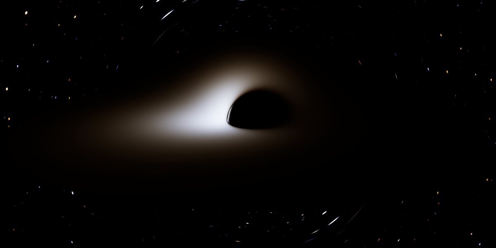
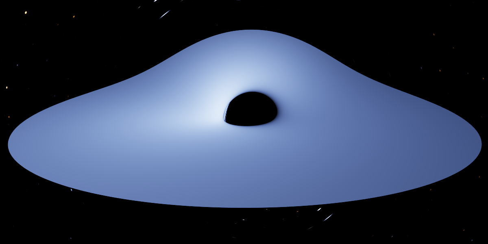
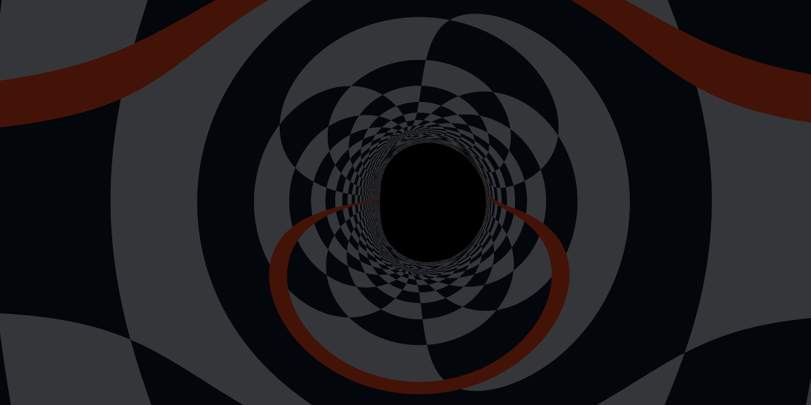
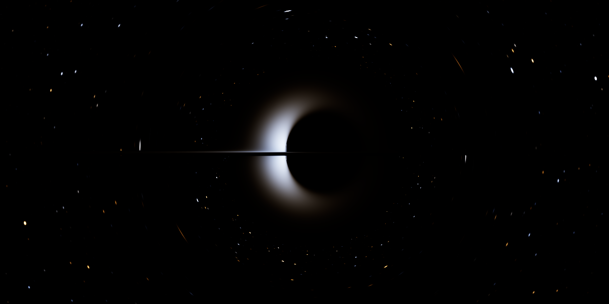

# Kerr black hole

A fast, physically accurate black hole renderer that runs in the browser on the GPU.
Every pixel is a null geodesic of the Kerr metric integrated with an adaptive
high-order method; the accretion disk is the general-relativistic Novikov–Thorne
thin disk, coloured as a redshifted blackbody. Nothing in the image is an artistic
approximation: the shadow shape, the photon ring, Doppler beaming, gravitational
redshift, frame dragging and the higher-order lensed images all fall out of the
geodesics. The GPU shader is tested pixel by pixel against an independent float64
reference implementation, which is itself tested against analytic results from the
literature.



| Quasar-like disk (10⁹ M☉, 0.3 L<sub>Edd</sub>) | Lensing of a coordinate grid | Near-extremal (a = 0.998), edge-on |
|---|---|---|
|  |  |  |

## Running it

No build step and no dependencies. Serve the folder and open it in any browser
with WebGL2 (Chrome, Edge, Firefox, Safari 15+):

```sh
npm start            # or: python3 -m http.server 8000
# open http://localhost:8000
```

Drag to orbit, scroll to change distance, shift-drag (or right-drag) to look around,
arrow keys and +/- also work. The panel exposes spin, camera, observer type, disk
mass and accretion rate, colour correction, limb darkening, background, exposure
and integrator tolerance. The image refines progressively (jittered
supersampling) whenever the view stops moving.

## The physics

Units are G = c = M = 1.

**Spacetime.** Kerr in Cartesian Kerr–Schild form,
g<sub>μν</sub> = η<sub>μν</sub> + f l<sub>μ</sub> l<sub>ν</sub> with
f = 2r³/(r⁴ + a²z²) and l = (1, (rx+ay)/(r²+a²), (ry−ax)/(r²+a²), z/r).
These coordinates have no singularity at the horizon or on the spin axis, so rays
are integrated straight through r₊ without the step size collapsing and without
pole hacks. [`src/physics/kerr.js`](src/physics/kerr.js)

**Geodesics.** Photons obey Hamilton's equations for
H = ½ g<sup>μν</sup>p<sub>μ</sub>p<sub>ν</sub> = ½(−E² + |p|² − f(E + k·p)²),
with fully analytic gradients (no finite differences). E and L<sub>z</sub> are
conserved exactly by construction; the Carter constant is not built in, and its
conservation is checked in the tests.

**Backward tracing without the past-horizon problem.** Camera rays are
past-directed, and past-directed rays pile up at the *past* horizon, which ingoing
Kerr–Schild coordinates do not cover. The tracer uses the time-reversal isometry
Kerr(a) → Kerr(−a): a past-directed ray in Kerr(a) is a future-directed ray in
Kerr(−a) with the same spatial path. Redshifts are invariant under the map, so the
image is identical while the integration stays regular everywhere.
[`src/physics/camera.js`](src/physics/camera.js)

**Integrator.** Dormand–Prince 5(4) with embedded error control (scaled by r for
positions), first-same-as-last stages, a step cap that prevents a single step from
crossing the disk plane twice, Newton refinement onto z = 0 at disk crossings, and
null-constraint projection on the GPU to remove float32 drift. With the default
tolerance a typical pixel needs about 14 steps (≈100 right-hand-side
evaluations), which is what makes it fast.
[`src/physics/tracer.js`](src/physics/tracer.js)

**Observer.** The camera is a zero-angular-momentum observer (valid anywhere
outside the horizon) or a static observer (outside the ergosphere). Pixel
directions are built in the observer's orthonormal tetrad (Gram–Schmidt in the
full metric), so aberration from the observer's motion is included.

**Accretion disk.** Geometrically thin, optically thick, equatorial, with gas on
prograde Keplerian orbits Ω = 1/(r<sup>3/2</sup> + a) from the ISCO
(Bardeen–Press–Teukolsky) outward. The emitted flux is the closed-form
Page–Thorne (1974) solution with a zero-torque inner edge, and the effective
temperature follows from σT⁴ = F with the accretion rate set physically from the
hole's mass, the Eddington ratio and the spin-dependent radiative efficiency
1 − E<sub>ISCO</sub>. [`src/physics/disk.js`](src/physics/disk.js)

**Radiative transfer.** Each disk hit records g = ν<sub>obs</sub>/ν<sub>emit</sub>
= (p·u<sub>obs</sub>)/(p·u<sub>gas</sub>), which combines gravitational redshift,
Doppler shift and frame dragging. Because I<sub>ν</sub>/ν³ is invariant, a
blackbody at T is seen as an exact blackbody at gT; the pixel colour is Planck's
law integrated against the CIE 1931 observer and converted to linear sRGB, so
beaming (bolometric I ∝ g⁴) is automatic. Optional extras: spectral hardening
I<sub>ν</sub> = f<sub>col</sub>⁻⁴ B<sub>ν</sub>(f<sub>col</sub> gT), and
electron-scattering limb darkening (Chandrasekhar), normalised to conserve flux.
[`src/physics/color.js`](src/physics/color.js)

**Background.** Escaping rays sample a procedural star field (blackbody stars,
also shifted by g) or a coordinate grid. Stars are tiny blobs on the celestial
sphere, so lensing magnification shows up through surface-brightness
conservation, exactly as in nature.

## Throwing things in

The **Throw something in** panel launches bodies at the hole and runs time
forward. They are simulated in double precision (in a Web Worker) and drawn by
the same ray tracer, so every image of a body is properly lensed.

| Object | Model |
|---|---|
| Probe with a clock | A test body on a timelike Kerr geodesic carrying a parallel-transported frame. The panel shows its radius, its own proper time, dτ/dt and the tidal stretch across a 2 m body in physical units. It flashes every 10 M of its proper time, so time dilation is visible directly. |
| Dust cloud | 400 pressureless grains, each an independent exact Kerr geodesic: the cloud's deformation is the exact (all-order) tidal field. |
| Stars (white dwarf, red dwarf, Sun-like, hot massive star, red giant envelope) | A self-gravitating polytrope (n = 1.5 or 3) simulated with smoothed-particle hydrodynamics in the free-falling frame of its centre of mass, squeezed and stretched by the exact Kerr tidal tensor. After pericentre (or once it is too large for that frame), each gas parcel that is not bound to a surviving core follows its own Kerr geodesic. |

Launch options: orbit (parabolic, hyperbolic, radial plunge), pericentre or
penetration factor β = r<sub>t</sub>/r<sub>p</sub>, orbital inclination, and
where the pericentre lies relative to the camera. The black hole's mass (in
Spacetime) sets the physical scale: whether a star is torn apart or swallowed
whole, the time units, and the tidal forces.

**Spacetime and orbits.** Timelike geodesics use the same Kerr–Schild
Hamiltonian as the photons, with an adaptive Dormand–Prince 5(4) integrator and
Hermite dense output. Initial data come from the constants of motion (E,
L<sub>z</sub>, Carter Q) with the pericentre placed by root finding on the
radial potential; orbits whose pericentre lies inside the capture radius
become plunges. [`src/physics/spacetime.js`](src/physics/spacetime.js)

**Tides.** The Riemann tensor is built from the Petrov type D structure of Kerr
(Ψ₂ = −M/(r − ia cos θ)³ in a principal frame), which stays regular through the
horizon, and projected onto the body's parallel-transported tetrad to give the
tidal tensor C<sub>ij</sub> = R<sub>0i0j</sub>.

**Stars.** Lane–Emden polytropes are relaxed with SPH (cubic-spline kernel,
entropy formulation, Monaghan artificial viscosity with the Balsara switch,
spline-softened self-gravity, kick–drift–kick). In the Fermi normal coordinates of
the centre of mass, each particle feels its self-gravity, pressure and the tide
−C<sub>ij</sub>ξ<sup>j</sup>. [`src/physics/star.js`](src/physics/star.js),
[`src/sim/events.js`](src/sim/events.js)

**Outcome and fallback.** At the switch to ballistic motion the debris'
specific orbital energies give the classic fallback rate (Kepler's third law for
the bound debris), shown as a chart against t<sup>−5/3</sup> and the Eddington
rate, together with the bound, unbound, swallowed and surviving-core fractions.

**What you see.** Each ray carries the mirror time at which its light left a
body, so the image includes the light-travel delay, the different ages of the
direct and lensed images, gravitational and Doppler redshift (the colour is a
blackbody at gT with T the body's surface temperature), Eddington limb darkening
for stars, and the image of an infalling body freezing and fading at the
horizon. Body world lines are resampled on a grid in ray time and uploaded to the
GPU each frame. [`src/render/objects.js`](src/render/objects.js)

## How accuracy is verified

`npm test` runs the float64 reference against known results:

| Check | Result |
|---|---|
| Analytic Hamiltonian gradient vs central finite differences | agrees to 1e-7 relative |
| g<sup>μν</sup> g<sub>νλ</sub> = δ, Kerr–Schild radius inversion | 1e-12 |
| Null constraint, L<sub>z</sub> and Carter constant along strong-field orbits (a = 0, 0.7, −0.998) | drift below 1e-9 |
| Equatorial shadow edges vs circular photon orbit impact parameters b = ∓a + 6 cos(⅓ arccos(∓a)) | 2e-6 relative, flattened edge on the approaching side |
| Capture vs escape for inclined views vs the analytic Kerr shadow (radial potential R(r)) | every unambiguous ray agrees |
| Face-on disk redshift vs 1/u<sup>t</sup> (transverse Doppler + gravitational) | 1e-8 |
| ISCO, photon orbits, efficiency (0.0572 at a = 0, 0.32 at a = 0.998) | to quoted precision |
| Closed-form Page–Thorne flux vs direct numerical integration of the torque integral | 2e-5 relative |
| Blackbody chromaticity vs CIE illuminant A and the Planckian locus near D65 | 0.003 |

`npm run test:gpu` renders raw ray data (hit type, radius, redshift, escape
direction) with the actual WebGL2 shader in headless Chromium, at the default
interactive tolerance, and compares every pixel with the float64 reference
(tolerance 1e-9) on five scenes including a = 0.998 edge-on and a retrograde disk:

| Metric | Typical result |
|---|---|
| Pixels classified identically (horizon / disk / sky) | 100% |
| Disk-hit radius, median relative error | ~1e-5 |
| Redshift g, median absolute error | ~1e-6 (99th percentile ~5e-5) |
| Escape direction, median angular error | ~1e-5 rad |

The only larger differences sit on the photon ring, where geodesics are chaotic
and any finite precision is amplified by about e<sup>π</sup> per half orbit.

### Dynamic bodies

| Check | Result |
|---|---|
| Analytic Christoffel symbols and Riemann tensor vs finite differences (also inside the horizon) | agree to the FD error |
| Tidal eigenvalues for radial infall, (−2, 1, 1)M/r³ | 1e-10 |
| Tidal eigenvalues on equatorial circular Kerr orbits vs Marck (1983) | 1e-9 |
| Proper time of radial infall through r = 2M vs the cycloid solution | 2e-8 relative |
| Circular orbits (r = 12M): radius drift, orbital phase | < 3e-6, 2e-6 |
| Pericentre advance vs quadrature of the radial and azimuthal integrals | 2e-7 relative |
| Geodetic precession of the transported frame, −2π(1 − √(1 − 3M/r)) per orbit | 1e-6 |
| Lane–Emden surface ξ₁ and mass for n = 1, 1.5, 3 (Chandrasekhar 1939) | 2e-5 |
| Isolated SPH polytrope: virial balance, half-mass radius, energy over 3 dynamical times | 3%, 3%, 2e-3 |
| Fermi-frame tidal dynamics vs neighbouring exact geodesics on a deep flyby | error ∝ ξ (first order in size/r, as expected), 1.2e-3 relative at ξ = 0.005M |
| Tidal disruption (β = 2): debris energy spread vs GM R*/r<sub>t</sub>² | within 0.7–1.6 ×, bound/unbound ≈ 1:1 |
| First fallback time vs 2π(M/2Δε)<sup>3/2</sup> | within 0.3–1.5 × |
| Grazing (β = 0.5) encounter keeps > 85% of the star; a Sun-like star at 3×10⁸ M☉ is swallowed whole | ✓ |
| Light-travel time along a radial ray, t′ + r = const | 1e-8 |
| Redshift of a radially infalling body, g = (1 − √(2M/r))/√(1 − 2M/r<sub>obs</sub>), at the retarded time | 1e-4 |

Partial-disruption thresholds come out at β ≈ 0.7 (19% stripped) to β = 1 (70%)
for n = 1.5 and about β ≈ 1.8 (77%) for n = 3, consistent with Guillochon &
Ramirez-Ruiz (2013).

`npm run test:gpu` also renders three scenes with bodies (a probe at pericentre,
a dust stream crossing the disk plane, a white dwarf being torn apart) and
compares the GPU against the float64 tracer reading the same data: the body
seen first agrees on 100% of pixels, with redshift differences of 1e-7 to 4e-5
(median).

## Layout

```
index.html                  viewer page
src/physics/                float64 reference (also used by the UI for the camera)
  kerr.js                   metric, Hamiltonian, analytic gradients, invariants
  tracer.js                 Dormand–Prince 5(4) tracer with disk intersection
  camera.js                 observers, tetrads, time-reversal mapping
  disk.js                   ISCO, Kepler orbits, Page–Thorne flux, temperatures
  color.js                  Planck × CIE 1931 → linear sRGB lookup table
  ode.js                    Dormand–Prince 5(4) with dense output
  spacetime.js              Christoffels, Riemann/tides, timelike orbits, mirror map
  star.js                   SPH polytropes
src/sim/                    probes, dust clouds and tidal disruptions (runs in a Worker)
src/render/                 WebGL2 shader (port of the physics files) and renderer
  objects.js                resampling of body world lines for the GPU
src/ui/                     controls, navigation and the "throw something in" panel
test/                       analytic tests (node:test) and the GPU-vs-reference test
```

## Known limitations and next steps

- The disk model is the standard thin, optically thick Novikov–Thorne disk. It is
  the right model for luminous disks (roughly 0.01–0.3 L<sub>Edd</sub>); very low
  accretion rates are better described by hot, optically thin flows. A natural
  next step is a covariant radiative-transfer mode (emission/absorption integrated
  along each ray) for EHT-style images of M87* and Sgr A*.
- No returning radiation (disk light that is bent back onto the disk), no
  emission from the plunging region inside the ISCO, and no polarisation.
- Dynamic bodies: the star's tidal field is quadrupole order (exact while the
  star is small compared with its distance, as in all TDE codes of this kind);
  self-gravity is Newtonian; resolution is a few hundred to ~1000 SPH particles,
  so the outcome fractions are good to roughly ±10%. Debris after disruption is
  ballistic (no pressure or self-gravity), grouped into ellipsoids for drawing,
  and keeps the star's surface temperature (no cooling, no shocks, no accretion
  flare). Bodies are opaque blackbodies; samples within a hair of the horizon
  (u<sup>t</sup> > 10³, g ≲ 10⁻³) are dropped.
- The GPU integrates in float32; the tests show this is far below visible error,
  and the float64 reference is available for offline work.

## References

- J. M. Bardeen, W. H. Press, S. A. Teukolsky (1972), ApJ 178, 347 — ISCO, photon orbits.
- J. M. Bardeen (1973), in *Black Holes (Les Houches)* — the Kerr shadow.
- I. D. Novikov, K. S. Thorne (1973); D. N. Page, K. S. Thorne (1974), ApJ 191, 499 — relativistic thin disks.
- K. S. Thorne (1974), ApJ 191, 507 — spin limit and efficiency.
- C. T. Cunningham (1975), ApJ 202, 788 — disk redshift maps.
- S. Chandrasekhar (1960), *Radiative Transfer* — limb darkening.
- J. R. Dormand, P. J. Prince (1980), J. Comp. Appl. Math. 6, 19 — the integrator.
- C. Wyman, P.-P. Sloan, P. Shirley (2013), JCGT 2(2) — CIE 1931 fit.
- O. James, E. von Tunzelmann, P. Franklin, K. S. Thorne (2015), Class. Quantum Grav. 32, 065001 — rendering with observer tetrads.
- J.-A. Marck (1983), Proc. R. Soc. A 385, 431 — parallel-transported frames and tides in Kerr.
- S. Chandrasekhar (1939), *An Introduction to the Study of Stellar Structure* — polytropes.
- J. J. Monaghan (1992), ARA&A 30, 543; D. S. Balsara (1995), J. Comput. Phys. 121, 357 — SPH.
- M. J. Rees (1988), Nature 333, 523; C. R. Evans, C. S. Kochanek (1989), ApJ 346, L13 — tidal disruption and fallback.
- J. Guillochon, E. Ramirez-Ruiz (2013), ApJ 767, 25 — disruption thresholds.
